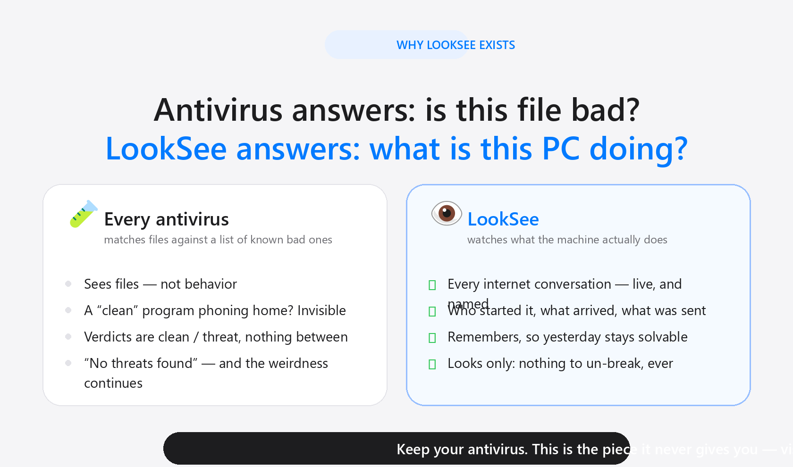
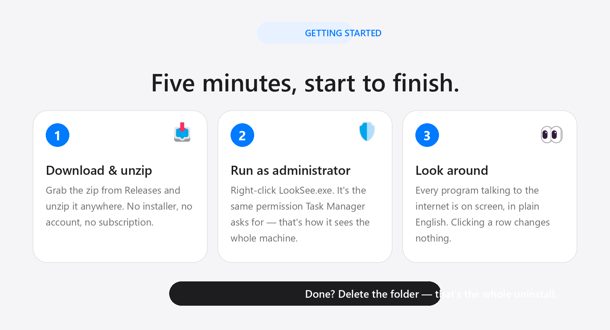
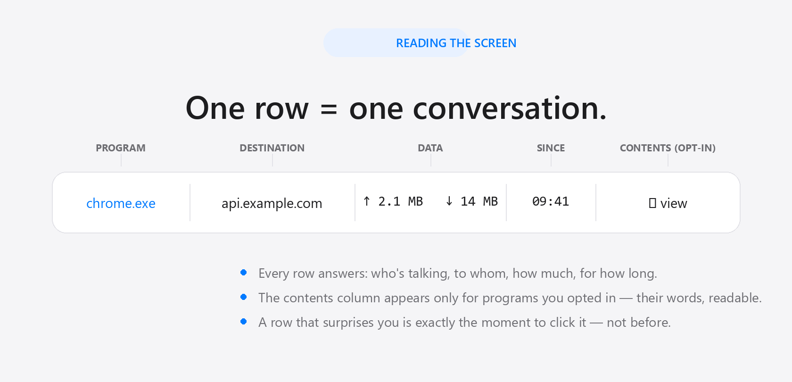
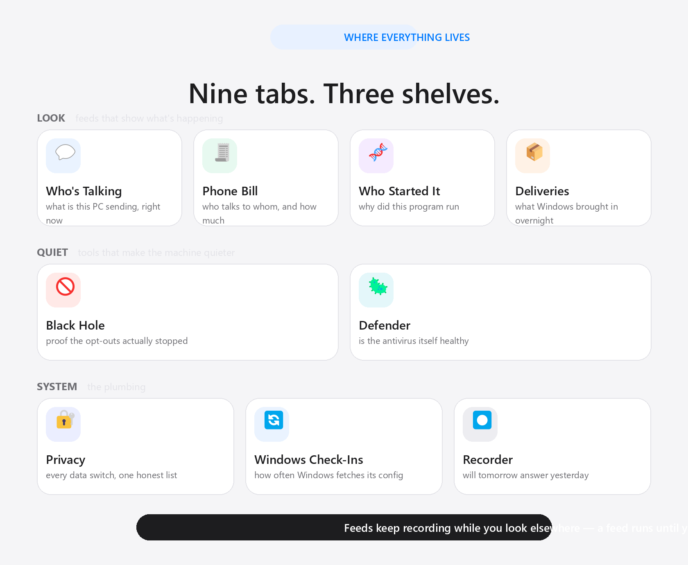

# LookSee — take a look-see at what your Windows PC is really doing

**Your computer is having a thousand small conversations right now — updates phoning home, browsers chattering, mystery programs beeping quietly into the dark. LookSee shows you all of it, in plain English, without changing a single thing.**

LookSee is a free, open-source app for Windows that watches what your PC does — who's talking to whom, who launched what, what arrived overnight — explains each thing in everyday words, and remembers what it saw so yesterday's mystery is still solvable tomorrow. It looks; it never stops anything. It sends nothing anywhere, costs nothing, and deleting the folder uninstalls it completely.

[](LICENSE)



## Why LookSee exists

It started with a genuinely unsettling message on a real machine: **"svchost.exe is uploading packets."** svchost is Windows' own host process — seeing it "upload" sounds like the beginning of a very bad week. The antivirus said *"no threats found"* twice, which was true and useless: it answers *"is this file on the list of known bad things?"* — and a clean program phoning home more than it should is invisible to exactly that question.

The answer turned out to be one row of data — it was Chrome's updater, downloading from Google's own servers — but getting that one row required tools aimed at forensics professionals, and the scary message arrived long before the reassurance did.

So the app was built around a simple conviction: **you shouldn't need to be a forensic analyst to know what your own computer is doing.** Every program that talks to the internet, on one screen, explained in plain English, with the history kept so the question you have *tomorrow* about *yesterday* still has an answer. And because the scariest failures of security tools are the ones where they break your machine while "protecting" it, LookSee was made watch-only from the first line: it observes, it explains, it remembers — it never stops anything. There is nothing to un-break.

Keep your antivirus; it does a different job. This is the piece it never gives you: **visibility**.

## Try it in five minutes



1. **Download** `LookSee-v…-win-x64.zip` from [Releases](../../releases) and unzip it anywhere. There's no installer.
2. **Right-click `LookSee.exe` → Run as administrator.** (That permission lets it watch the whole machine — the same reason Task Manager asks.) The first screen — **Who's Talking** — lists every program talking to the internet right now.
3. **Look around.** Click any row to see what it actually sent. Wondering "why did this run?" — the **Who Started It** tab answers it. Curious what Windows delivered overnight? **Deliveries**.

> **Windows may show a blue "protected your PC" screen** because the app isn't from a big company. Click **More info → Run anyway**. It's open source — anyone can read exactly what it does, and that's rather the point.

## Reading the screen



The main screen is a list of rows — one per conversation. Every row tells you who's talking, to whom, how much, and for how long. When a row surprises you, *that's* the moment to click it — not before. Most rows, you'll never need to think about.

## The three shelves: LOOK, QUIET, SYSTEM



The sidebar is grouped by the question you're asking.

### LOOK — feeds that show what's happening

| Tab | The question it answers |
|---|---|
| 💬 **Who's Talking** | What is this machine actually sending to the cloud, right now? Each row is a conversation: which program, which destination, how much — and (for programs you've opted in) the decrypted contents, so "phoning home" becomes words you can read. |
| 🧾 **Phone Bill** | Who talks to whom, and how much? Totals per program and destination over a window you choose — like a phone bill for your PC. |
| 🧬 **Who Started It** | "Why did this run?" Three feeds: every scheduled-task launch with the task behind it, Python programs with their call stacks (if you opt in to instrumentation), and the svchost family tree with its connection timeline. A dot on each feed glows green while it records. |
| 📦 **Deliveries** | What did Windows bring in overnight? Every Background Intelligent Transfer job — where it connected, what it moved, how often, why — and whether it bypasses the firewall (a read-only fact, honestly labeled). |

### QUIET — tools that make the machine quieter

| Tab | The question it answers |
|---|---|
| 🚫 **Black Hole** | "I opted out — did they stop?" Pins known telemetry domains to a local black hole, then shows every program that still knocks, with proof. Fully reversible. |
| 🦠 **Defender** | Is the antivirus itself alive and behaving? Live resources, scan history, and a plain-English card of every data-sharing preference it has. |

### SYSTEM — the plumbing

| Tab | The question it answers |
|---|---|
| 🔐 **Privacy** | What data-sharing settings are actually on? Every Windows telemetry switch in one list — plus draft privacy-request letters when you want a vendor's paperwork. |
| 🔄 **Windows Check-Ins** | How often does Windows fetch its remote config (the "OneSettings" experiment flags)? Slows the fetch to a cadence you choose — and proves it's holding. |
| ⏺ **Recorder** | Will yesterday still be answerable tomorrow? Sysmon records every process launch and connection so short-lived programs stay traceable; this tab shows the recorder's health and retention. |

One rule everywhere: **feeds keep recording while you're on another tab** — a feed runs until you stop it, not until you click away.

## When something looks odd

Real example, from this app's sibling's development machine: *"svchost.exe is uploading packets"* sounds alarming — it turned out to be Chrome's updater downloading from Google's own servers, and one row proved it. No panic, no reinstall, no forum archaeology at midnight.

And because LookSee only ever *looks*, there is nothing to un-break: no blocks to undo, no firewall to restore, no "I clicked something and the internet died." The one thing it can change — telemetry pins in **Black Hole** — un-pins from the same screen, one click.

## Your privacy, in one sentence

Everything happens on your computer; LookSee talks to no one, and everything it remembers is a readable file on your own disk (the complete list is in the [Technical Notes](docs/TECHNICAL_NOTES.md)).

## LookSee and AutoCommand

LookSee is the watch-only lens from [AutoCommand](https://github.com/dparksports/autocommand-windows) — same author, same plain-English ethos, same undo-first design — distilled to pure visibility. If you want to *stop* things (firewall presets, one-click blocks, an invited AI second opinion), that's what AutoCommand is for; the two apps run side by side without sharing state.

## Downloads

| File | For |
|---|---|
| `LookSee-v…-win-x64.zip` | Windows 10 and 11 — unzip anywhere, right-click `LookSee.exe` → **Run as administrator**. Nothing else to install. |

## For developers and tinkerers

```powershell
# .NET 10 SDK required
git clone https://github.com/dparksports/looksee-windows.git
cd looksee
dotnet build LookSee.csproj -c Release

# self-contained build (what the releases ship)
dotnet publish LookSee.csproj -c Release -r win-x64 --self-contained

# regenerate the README infographics and the icon candidates (Python + Pillow + numpy)
python Assets/generate_infographics.py
python Assets/generate_icon.py
```

How it actually works — the dual-family kernel connection table, the Sysmon archive, the TLS-decrypt pipeline, every engine's offline self-test — is documented in **[TECHNICAL_NOTES.md](docs/TECHNICAL_NOTES.md)**. Apache 2.0.

## Credits & license

Made with ❤️ in California

Apache License 2.0 — free to use, share, and modify

© 2026 Dan Park, magicpoint.ai

Questions, stories, things you caught? [Say hello in Discussions](../../discussions).
